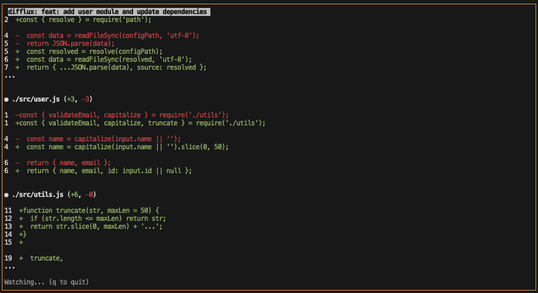

# Difflux

> A clear, live view of changes made in a Git repository—especially changes created by AI agents.

[](https://github.com/apmaricich/difflux/actions)
[](./LICENSE)
[](https://www.npmjs.com/package/difflux)

## About the Project

Difflux is a small command-line tool that turns Git's native `git diff` output into a more readable terminal experience. It compares the current working tree with `HEAD`, highlights additions and deletions, and lets you inspect changes within a specific directory.

The tool was built to make it easier to review what an AI agent is changing in an application. Live monitoring shows those changes as they happen, while a custom terminal renderer helps you keep your place when reviewing a long diff.



> Add a captured screenshot to `docs/screenshots/diff-output.png` when one is available.

## Features

- Display a complete diff between `HEAD` and the current working tree.
- Limit output to a specific file or directory.
- View changed files as a sorted directory tree with addition and deletion counts.
- Watch a repository for live changes using filesystem notifications.
- Periodically refresh output to catch changes made through Git index operations.
- Preserve relative scroll position while reviewing long outputs.
- Configure the watch refresh interval from 1 to 60,000 milliseconds.
- Sanitize terminal control characters from repository content before displaying it.


> Add a short GIF to `docs/screenshots/live-watch.gif` showing watch mode, scrolling, and the refresh prompt.

## Built With

- [Node.js](https://nodejs.org/) — JavaScript runtime
- [npm](https://www.npmjs.com/) — package installation and command execution
- [Chokidar](https://github.com/paulmillr/chokidar) — filesystem event monitoring
- [Git](https://git-scm.com/) — version control and diff engine


## Getting Started

### Prerequisites

Install the following before running Difflux:

- [Node.js](https://nodejs.org/) version `20.19.0` or newer
- [Git](https://git-scm.com/) installed and configured
- [npm](https://www.npmjs.com/) version `10` or newer

No environment variables or additional configuration are required.

### Install the Project

Clone the repository and install its local dependencies:

```bash
git clone https://github.com/apmaricich/difflux.git
cd difflux
npm install
```

### Run in Development

Start the local CLI from the repository:

```bash
npm start
```

Difflux compares the current directory with `HEAD`. To inspect a subdirectory, provide its relative path:

```bash
npm start -- src
```

For a global installation, run the following from this repository:

```bash
npm install -g .
```

After installation, the `difflux` command is available in the terminal.

## Usage

### Show a Repository Diff

Display all unstaged and staged changes relative to `HEAD`:

```bash
difflux
```

Or run the repository-local copy:

```bash
npm start
```

### Inspect a Directory

Limit the diff to a file or directory inside the current working directory:

```bash
difflux -- src/agents
```

A clean path produces no diff output.

### Show Changed Files as a Tree

Use the `ls` command to display changed files with their addition and deletion counts:

```bash
difflux ls
```

Or restrict the view to a directory:

```bash
difflux ls -- src
```

### Watch for Live Changes

Run the normal diff view in watch mode:

```bash
difflux --watch
```

Inspect a subdirectory while it changes:

```bash
difflux --watch --interval=250
```

The default polling interval is `1000` milliseconds. The `--interval` option accepts a finite, positive integer from `1` to `60000`.

### Watch the Changed-File Tree

Watch the `ls` output as files are added, changed, or removed:

```bash
difflux ls --watch
```

Customize the polling interval:

```bash
difflux ls --watch --interval=250
```

Watch mode supports the following terminal controls:

- `↑` and `↓` — move through long output
- `r` — refresh while retaining the current relative scroll position
- `q` — quit the watcher
- `Ctrl+C` — stop the watcher

### Display Help

Show all available commands and options:

```bash
difflux --help
```

## Project Structure

```text
difflux/
├── AGENTS.md              # Project and development notes
├── index.js               # CLI entry point and rendering logic
├── package.json           # Package metadata, binary, and scripts
├── package-lock.json      # Reproducible dependency versions
├── test/
│   └── difflux.test.js    # Built-in Node.js CLI tests
└── README.md              # User documentation
```

## Contributing

Contributions are welcome. Please follow these steps:

1. Fork the repository.
2. Create a descriptive feature or fix branch.
3. Make the requested changes.
4. Run the test suite with `npm test`.
5. Start the CLI with `npm start` to verify the change manually.
6. Open a pull request with a clear summary and relevant test results.

Difflux uses Node.js's built-in `node:test` runner. There are currently no linting, type-checking, build, or code-generation scripts; inspect the package scripts before adding new verification tooling.

## License

**License: Unspecified**

The repository does not currently contain a `LICENSE` file. Before publishing Difflux for external reuse, add an appropriate license and update the license badge and link above.

## Contact

- Maintainer: [apmaricich](https://github.com/apmaricich)
- Repository: [apmaricich/difflux](https://github.com/apmaricich/difflux)
- Issue tracker: [GitHub Issues](https://github.com/apmaricich/difflux/issues)
